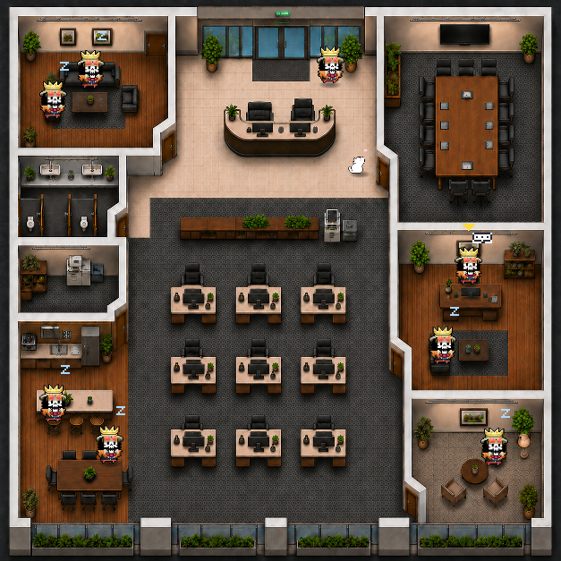
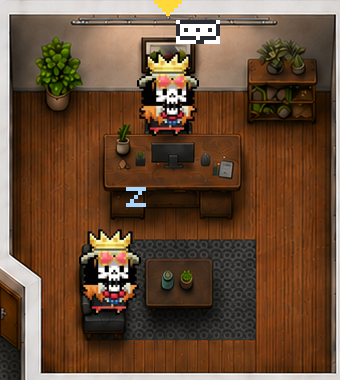
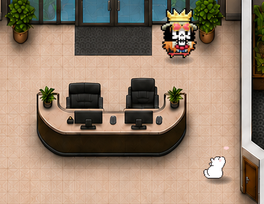

# claude-monitor

A terminal app that watches Claude Code agents. It shows what each session and
subagent is doing, how they interact (spawn, message, handback), and how many
tokens each one used.

It draws one pixel-art office (`assets/office.png`) for every session at once, sent to
the terminal as images (iTerm2, kitty or sixel; half blocks otherwise). Agents
are animated characters at desks, in the meeting room, in the lounges and the
kitchen, or walking through; a pet strolls round the lobby. Click one
to see what it did. Press `v` for the tree and tabs.



It is read-only. It reads transcript files under `~/.claude/projects` and every
`~/.claude-*/projects` (so the sessions of several accounts show together). Its
only network call is the one that shows each account's plan limits in the
tree's Usage tab (see [Accounts](#accounts)), made once that tab is shown;
`--offline` turns it off. It never calls Claude.

The app is the Rust crate at the repo root. Its pictures in `assets/` are built
into the binary, so it runs from any directory with no arguments.

## Install

There are three ways in: a release archive, a build from source, or a
cross-build of archives for other systems with `build.sh`.

### From a release archive

A release archive is one of the files `build.sh` writes to `dist/`. Each holds
one folder with the binary and this README.
Pick the archive for your system:

| System               | Archive                                              |
|----------------------|------------------------------------------------------|
| Linux x86_64         | `office-<version>-x86_64-unknown-linux-gnu.tar.gz` |
| Linux ARM64          | `office-<version>-aarch64-unknown-linux-gnu.tar.gz` |
| macOS Intel          | `office-<version>-x86_64-apple-darwin.tar.gz`   |
| macOS Apple silicon  | `office-<version>-aarch64-apple-darwin.tar.gz`  |
| Windows x86_64       | `office-<version>-x86_64-pc-windows-gnu.zip`    |
| Windows ARM64        | `office-<version>-aarch64-pc-windows-gnullvm.zip` |

#### Linux and macOS

1. Download the archive and `SHA256SUMS` into one folder.
2. Check the archive against `SHA256SUMS`:

   ```sh
   sha256sum -c --ignore-missing SHA256SUMS                         # Linux
   grep aarch64-apple-darwin SHA256SUMS | shasum -a 256 -c          # macOS
   ```

3. Extract it and enter the folder:

   ```sh
   tar -xzf office-0.1.0-aarch64-apple-darwin.tar.gz
   cd office-0.1.0-aarch64-apple-darwin
   ```

4. macOS only: the binary is not signed. A browser download marks it as
   quarantined, and macOS then refuses to open it. Remove the mark:

   ```sh
   xattr -d com.apple.quarantine office
   ```

   `No such xattr` means there was no mark. That is fine.
5. Run it:

   ```sh
   ./office
   ```

6. Optional: to run it from any directory, put the binary on your `PATH`:

   ```sh
   mkdir -p ~/.local/bin && mv office ~/.local/bin/
   ```

   `~/.local/bin` must be on your `PATH`.

`command not found` (on Arch, pacman's `database file for '...' does not exist`)
or `permission denied` means the shell never started office: it is not on your
`PATH` (run `./office` from its folder), or a bare binary sent without the
archive lost its executable bit (run `chmod +x office`).

#### Windows

1. Download the `.zip` and `SHA256SUMS`.
2. Check the archive in PowerShell. The hash must match its line in
   `SHA256SUMS`:

   ```powershell
   (Get-FileHash .\office-0.1.0-x86_64-pc-windows-gnu.zip).Hash.ToLower()
   ```

3. Extract it (right-click, Extract All) or in PowerShell:

   ```powershell
   Expand-Archive .\office-0.1.0-x86_64-pc-windows-gnu.zip -DestinationPath .
   cd .\office-0.1.0-x86_64-pc-windows-gnu
   ```

4. The binary is not signed. Unblock it, or SmartScreen asks first (More info,
   Run anyway):

   ```powershell
   Unblock-File .\office.exe
   ```

5. Open WezTerm or Windows Terminal, go to the folder and run:

   ```powershell
   .\office.exe
   ```

   The old console window (`conhost`) shows no images. Use WezTerm or Windows
   Terminal.

On Windows it reads `%USERPROFILE%\.claude\projects` and every
`%USERPROFILE%\.claude-*\projects`. Sessions that run inside WSL keep their
transcripts in the WSL home. Pass that with
`--root \\wsl$\<distro>\home\<you>\.claude\projects`.

#### Terminals that show images

| Terminal                                  | Drawn with |
|-------------------------------------------|------------|
| WezTerm (Linux, macOS, Windows)           | iTerm2 images |
| iTerm2 (macOS)                            | iTerm2 images |
| kitty (Linux, macOS)                      | kitty images |
| Windows Terminal 1.22 or newer            | sixel |
| foot, and other terminals with sixel      | sixel |
| Terminal.app, the Windows console, others | half blocks (coarse, but works) |

`--protocol auto` (the default) asks the terminal. Force one with
`--protocol iterm2`, `kitty`, `sixel` or `halfblocks`.

office keeps drawing whether or not its window has focus, so it stays live
beside the window you are working in.

### From source

1. Install Rust 1.85 or newer with rustup:
   - Linux and macOS:
     `curl --proto '=https' --tlsv1.2 -sSf https://sh.rustup.rs | sh`.
     macOS also needs the command line tools: `xcode-select --install`.
   - Windows: run `rustup-init.exe` from <https://rustup.rs>. It installs the
     Visual Studio C++ build tools it needs.
2. Get the code and build:

   ```sh
   git clone <this repository> claude-monitor
   cd claude-monitor
   cargo build --release
   ```

3. Run it, from any directory:

   ```sh
   ./target/release/office
   ```

   On Windows the binary is `target\release\office.exe`.

### Cross-build archives with build.sh

`./build.sh` builds the release archives for every system above.
It runs on Linux or macOS with bash. Targets build with `cargo zigbuild`, which
uses zig as the linker. A macOS host builds its own target with plain `cargo`.
Linux binaries link against glibc 2.17, so they run on old distros too.

1. Install what it needs, once:

   ```sh
   ./build.sh --setup
   ```

   This adds the rustup targets, installs `cargo-zigbuild`, and installs zig
   into `~/.local/opt` (linked from `~/.local/bin/zig`) when no zig is found.
   Without `--setup`, the script prints the install command for anything
   missing and stops.
2. Build every target, or name the ones you want:

   ```sh
   ./build.sh
   ./build.sh x86_64-pc-windows-gnu aarch64-apple-darwin
   ```

3. Check the result:

   ```sh
   cd dist && sha256sum -c SHA256SUMS
   ```

The archives and `SHA256SUMS` land in `dist/` at the repo root. Windows archives
are `.zip` when `zip` is installed, else `.tar.gz`. A target that fails does
not stop the others; the script lists it at the end and exits non-zero. The
macOS binaries are not signed.

## Run

```sh
./target/release/office            # from any directory, no arguments needed
./target/release/office --dump     # scan once, print the tree as text
./target/release/office --snapshot room.png   # render the room to a PNG, exit
```

`assets/office.png` (the room), `assets/character.gif` (the default character)
and `assets/pet.gif` (the pet) are built into the binary at compile time.

On Windows WezTerm from WSL, start it in a WezTerm window of its own:

```sh
./window.sh [office flags...]
```

The script builds the binary if needed. A window of its own keeps images out of
the `wezterm-mux-server`, which drops the whole domain when images are replaced
many times a second.

| Flag            | Default                    | Meaning |
|-----------------|----------------------------|---------|
| `--root DIR`    | `~/.claude/projects` and every `~/.claude-*/projects` | Projects directory; repeat for more |
| `--since DUR`   | `24h`                      | Only sessions whose transcript changed within DUR (`0` = all) |
| `--sprites DIR` | `$XDG_CONFIG_HOME/claude-monitor/sprites` (else `~/.config/claude-monitor/sprites`) | Custom character GIF/PNG files, see [Custom characters](#custom-characters) |
| `--dump`        | off                        | Scan once, print the tree, edges and usage as text, exit |
| `--snapshot OUT.png` | off                   | Scan once, render the room once a visitor has walked in (at most 30 s on), exit |
| `--offline`     | off                        | Never fetch the accounts' limits; the Usage tab's Accounts say `offline` |
| `--protocol P`  | `auto`                     | `auto`, `iterm2`, `kitty`, `sixel` or `halfblocks`; `auto` asks the terminal, else half blocks |
| `--font WxH`    | asked from the terminal    | Cell size in pixels when the terminal does not answer; with `--protocol`, nothing is asked (default `10x20`) |

`OFFICE_VIEW_TRACE=FILE` also appends every byte written to the terminal to
FILE, for debugging the image stream.

## One room

All sessions share one office. There are no session keys.

- **Rooms:** the office has work places and rest places.
  - *Work:* the manager's desk (right), the 3×3 desk grid of the open plan, and
    seven chairs round the meeting room's table (top right), taken once the nine
    desks are full.
  - *Rest:* the top-left lounge, the kitchen and dining table (left), the
    bottom-right lounge, and the sofa in the manager's office. Seats fill one
    room after another, so three idle agents sit in three rooms, not on one sofa.
  - The lobby, the washroom and the open plan's aisles are for walking and
    waiting. The copy room has no door on the picture, so nobody goes in.
- **Residents:** agents of active sessions take work and rest places. A
  session is active when a running Claude Code process holds it (its
  `sessions/<pid>.json` names it, so a quiet background session counts), or it
  has an agent that is running or active, or not done and busy in the last 5
  minutes. The most recently active lead gets the
  manager's desk; other leads and subagents take the desk grid, then the meeting
  room. Running and active agents work, idle ones rest and doze (`z`), done ones
  rest dimmed with a `✓` and walk out after 10 minutes. An agent waiting for
  you (a question, a plan to approve, or a permission prompt) stays at its desk
  with an orange `?` above its head, and its card says what it waits on.
  Residents beyond the
  free places walk around as visitors instead of overlapping.
- **Visitors:** agents of inactive sessions walk in from the entrance now and
  then, a few at a time, wander a short route through any room with a door
  (lounges, kitchen, washroom, meeting room, manager's office, lobby and open
  plan), and walk out again.
- **Pet:** a pet (`assets/pet.gif`) strolls round the lobby
  for good: along the aisles round the reception desk and to the lounge's and
  meeting room's doors, pausing 1 to 4 seconds at each stop, at half a
  visitor's pace. It never leaves the lobby, never goes to the entrance, and
  steps on when an agent stops where it waits. It is not an agent: it cannot be
  clicked or selected and has no links. It is sized so its usual frame is
  about 0.6 of a character's height (a jump in the GIF can reach higher).
- **Links:** a spawn, message or handback younger than 90 seconds is drawn as a
  still dotted line between the two agents, with a letter travelling along it.
  Visitors have no links.

The office shows no text except the card.

| The manager's office | The lobby |
|---|---|
|  |  |

The pictures in `docs/` are `office --snapshot` renders with the default
character (`--sprites` pointed at an empty directory), so they hold no custom
art.

## Keys

| Key                              | Action |
|----------------------------------|--------|
| click an agent (visitors too)    | select it and open its card: name, role (session lead, or subagent and its type), what it did, whom it dealt with |
| click elsewhere, `esc`           | close the card |
| `i`                              | open or close the card of the selected agent |
| `↑`/`↓`, `k`/`j`, `tab`, wheel   | select the previous or next agent |
| `enter`                          | open the selected agent in the tree view |
| `p`                              | open the tree on the selected agent, typing in its session's [prompt panel](#prompt-panel) |
| `v`                              | switch between the office and the tree view |
| `r`                              | rescan |
| `q`, `esc`, `ctrl+c`             | quit (`esc` closes an open card first) |

In the tree view, `enter`/`space` collapse and `tab`, `1` `2` `3` switch tabs.

## Custom characters

Put your own `.gif` or `.png` characters in the sprites directory
(`~/.config/claude-monitor/sprites` by default, or `--sprites <dir>`). Each
agent picks, in order:

1. the file named after its agent type: `general-purpose.gif`, `Explore.png`,
   `my-agent.gif`, and `session.gif` for the main agent;
2. otherwise one of the files not named after an agent type in use, chosen by a
   stable hash of the agent id;
3. otherwise the default character, `assets/character.gif`.

Animated GIFs keep their frame delays. A missing directory or a broken file
never stops the monitor.

These files stay on your machine. Keep them in the sprites directory, not in
this repository: `sprites/` is in `.gitignore`.

## Art and licensing

The room is `assets/office.png`, the default character is
`assets/character.gif` and the pet is `assets/pet.gif`, all built into the
binary. Custom sprites are loaded only
from your local directory at run time and are never copied anywhere; only use
art you have the right to use.

## Tree view

Press `v` to switch between the office and the tree.

### Screen

- **Header:** session, agent and running counts, last scan time, time window.
- **Left pane:** a collapsible tree of sessions and their subagents, nested
  subagents included. Each row shows status, title, agent type, model, the
  agent's own tokens and the age of its last activity.
- **Right pane, tab 1 Activity:** the selected agent's details and its last 50
  events, newest first. While it runs, `now:` shows the pending tool call.
- **Tab 2 Interactions:** edges into and out of the selected agent, plus an
  ASCII graph of its session with spawn labels, messages and handbacks.
- **Tab 3 Usage:** first the Accounts (below), then a token bar per agent in
  the session, totals by model and the session total.

### Accounts

The Usage tab starts with every account's plan limits, as bars like the
session's:

```
Accounts  fetched 01:21:43
default               token expired, open claude with this account
personal 5h           ███████████████████████ 100%  resets 02:00
         7d           ████████░░░░░░░░░░░░░░░  39%  resets Thu 18:00
work 5h               ███████████░░░░░░░░░░░░  52%  resets 03:40
     7d               ██░░░░░░░░░░░░░░░░░░░░░  12%  resets Sun 05:00
```

- An account is `~/.claude` (`default`) or a `~/.claude-<name>` directory
  (`<name>`) holding `.credentials.json` (`%USERPROFILE%` on Windows).
- The numbers come from `GET https://api.anthropic.com/api/oauth/usage` with
  the account's OAuth access token (`five_hour` and `seven_day`:
  `utilization` in percent and `resets_at`), the request Claude Code's own
  usage display makes. Reset times are local.
- The token is only read: never refreshed, written, shown or logged. An
  expired one is not sent; log in again by opening `claude` with that account.
- Fetching starts the first time the Usage tab shows, in the background, then
  runs once a minute per account, and again on `r` (never twice within 10 s).
  `--dump` and `--snapshot` never fetch, nor does `--offline`.
- A failure is one line instead of the bars: `offline`, `timeout`, `HTTP 429`,
  `token rejected (HTTP 401)`, and so on.

Status glyphs:

| Glyph | Status  | Rule                                                              |
|-------|---------|-------------------------------------------------------------------|
| `?`   | waiting | last tool_use has no tool_result, nothing written for 3s (up to 1h), and it stops for you: always for `AskUserQuestion` and `ExitPlanMode`; in `default` (manual) and `plan` mode for any tool but reads, searches and spawns; in `acceptEdits` for any of those but file edits; never in `auto` or `bypassPermissions`. Subagents use their session's mode. |
| `●`   | running | last tool_use has no tool_result yet and the file was written < 2m ago |
| `◐`   | active  | file written < 30s ago                                            |
| `○`   | idle    | otherwise                                                         |
| `✓`   | done    | subagent meta says `finished: true`                               |

The transcript records no line when a permission prompt opens or is answered,
so `?` is inferred: in a mode that asks, a command you already approved that
runs longer than 3 seconds also shows `?` until it finishes, and so does one
your settings allow without asking.

### Tree keys

| Key               | Action                     |
|-------------------|----------------------------|
| `↑`/`↓`, `k`/`j`  | move the selection         |
| `enter`, `space`  | collapse or expand a node  |
| `tab`             | next tab                   |
| `1` `2` `3`       | Activity, Interactions, Usage |
| `p`               | type in the prompt panel   |
| `o`               | resume the selected session in the background, then type in its panel |
| mouse drag        | select text inside one pane (tree, prompt or details) and copy it to the clipboard on release, through the terminal (OSC 52; in tmux, `set -g set-clipboard on`) |
| `v`               | switch to the office view  |
| `r`               | drop all state and rescan  |
| `q`, `ctrl+c`     | quit                       |

## Prompt panel

Under the tree sits a panel for the session of the selected row (a subagent's
row means its session). From it you can answer the session's permission
request or send it a prompt, in any terminal: office talks to Claude Code
through Claude Code's own hooks, never by typing into another window.

Install the hooks once, into the `settings.json` of `~/.claude` and every
`~/.claude-*` (a copy of the old file is kept as `settings.json.bak-office`),
then restart the sessions you want to reach:

```sh
office hook install      # office hook uninstall removes them again
```

Run it with the `office` you keep, such as `~/.local/bin/office`: the hooks
run that very file, so a build directory that gets cleaned breaks them. Run it
again after updating office; when the installed hooks are older than this
office, the panel says they are out of date. A running session keeps the hooks
it started with, so restart it (or `o` to resume it) to pick up new ones.

Press `p` on an agent in the office, or in the tree. While the panel has the
keys (orange border), every key is text; `esc` gives them back to the tree.

The panel reads like Claude Code's own: the session's conversation fills it,
newest at the bottom (your prompts after `>`, its replies after `●`, whole and
wrapped, its tool calls on one line each, prompts sent from office included;
prompts the session has not taken yet show last, dim, marked not taken yet),
and you type in a rounded box under it. What the session waits on sits just
over the box: a permission request (`asks: Bash: rm -rf build`), a question
with its numbered options (asked one at a time when there are several), or a
plan waiting for approval.

| Key              | Action |
|------------------|--------|
| text, `enter`    | send the prompt to the session |
| `/`              | list the session's slash commands as you type; `↑`/`↓` pick, `tab` completes, `enter` runs the picked one |
| `←` `→`, `home` `end` | move the cursor; `ctrl`/`alt`+`←` `→` by word |
| `backspace` `delete`, `ctrl+w` `ctrl+u` `ctrl+k` | delete a char, the word before, or to the start or end |
| `1` `2` `3`      | with an empty prompt: answer the waiting permission request yes · yes, don't ask again · no |
| `1`…`9`          | with an empty prompt: pick that option of the session's question; or type your own answer and `enter` |
| `pgup` `pgdn`, mouse wheel | scroll the conversation; sending a prompt goes back to the newest |
| `↑`/`↓`          | with no command list: walk this project's earlier prompts, newest first (Claude Code's own history and those sent from office); `↓` past the newest brings back what you were typing, and any edit ends the walk |
| `ctrl+x`         | take back the last prompt sent that the session has not taken yet; it goes back into the box to edit |
| `esc`            | back to the tree |
| `ctrl+c`         | quit |

The panel says whether a Claude Code process holds the session (`running`).
When none does, `o` in the tree resumes it with `claude --resume <id> --bg`,
in the session's folder and under its config dir: Claude Code's own
background session, which needs no terminal. Its waiter starts with it, so
prompts from the panel reach it; `claude attach <id>` shows it in a terminal,
`claude stop <id>` ends it. A session already running is not started twice.
Sending a prompt to a session that is not running resumes it the same way, so
the prompt reaches it with no terminal open.

A background session cannot ask whether to trust its folder, so Claude Code
refuses one in a folder that account has not trusted yet (and always in your
home directory). The panel then says so, with the command that trusts it, and
`o` again runs `claude --resume <id>` right in office's terminal: answer
Claude Code's trust prompt there and use the session; office comes back when
you exit Claude. Once trusted, `o` resumes it in the background. office
never marks a folder trusted itself.

How it works (files in `$XDG_STATE_HOME/claude-monitor/bridge`, else
`~/.local/state/claude-monitor/bridge`):

- **Permission requests:** a `PermissionRequest` hook (`office hook permission`)
  files each request while office runs and waits up to 10 minutes for its
  answer. Claude Code shows its own dialog all along: answer either place.
  When office is not running, the hook returns at once and changes nothing.
  "Yes, don't ask again" adds the rule Claude Code itself suggests.
- **Headless runs** (`claude -p`, the Agent SDK) are left alone by both hooks:
  they end on their own, and would wait on a waiter.
- **Prompts:** `Stop` and `SessionStart` hooks (`office hook wait`) start a
  background waiter that never blocks the session (`asyncRewake`). A prompt
  you send wakes an idle session at once. Sent to a busy one, Claude Code hands
  it over during or after that turn. Prompts sent before the session takes one
  queue up and arrive in the order sent, one per turn. The waiter waits up to
  24 hours: its hook sets that as its `timeout`, because Claude Code kills a
  hook after its timeout, background ones too, and the default is 10 minutes.
  A session with no waiter (not started or ended a turn since the hooks were
  installed) takes a prompt at the end of its next turn; the panel says
  "queued" and why. The session reads it as a hook message that says it came
  from claude-monitor, not as text typed into its prompt box.
- **Taking a prompt back:** each prompt not taken yet is a file,
  `prompt-<time>.txt`, in the session's folder there; `ctrl+x` deletes the
  newest, so the session never reads it. Once the hook has taken it, there is
  nothing left to take back.
- **Sessions that moved on:** `/resume` or `/clear` in a terminal moves its
  conversation to another session id. The old id no longer counts as running,
  so the panel does not offer it as one; the conversation goes on under the
  new id.
- **Prompt history:** prompts sent from office are appended to `history.jsonl`
  there. `↑`/`↓` merge it by time with the account's own `history.jsonl`,
  which only Claude Code writes.
- **Slash commands:** that hook message never reaches Claude Code's command
  parser, so office sends a command as its file instead: a skill's `SKILL.md`
  or a custom command's `.md`, from the project's `.claude`, the account, or an
  enabled plugin, for the session to read and follow with your arguments.
  Built-ins such as `/clear`, `/compact` and `/model` have no file and run only
  in the session's own terminal; the panel says so and keeps them typed.

## Data sources

Transcripts are under `--root` (default `~/.claude/projects` and every
`~/.claude-*/projects`). Besides them, office reads these files of each account
(`~/.claude` and every `~/.claude-*`), and never writes them except where noted:

| File | For |
|------|-----|
| `.credentials.json` | the [Accounts](#accounts) limits |
| `sessions/<pid>.json` | which sessions a running Claude Code process holds |
| `settings.json` | whether the hooks are installed, and the enabled plugins; `office hook install` and `uninstall` write it |
| `plugins/installed_plugins.json`, `skills/`, `commands/`, and the project's `.claude/` | the slash commands of the [prompt panel](#prompt-panel) |
| `history.jsonl` | the prompts `↑`/`↓` recall in the prompt panel |

- `<project>/<sessionId>.jsonl`: the main session, one JSON object per line.
  The project directory is the session cwd with `/` replaced by `-`; the UI
  shows the last segment of the cwd.
- `<project>/<sessionId>/subagents/agent-<agentId>.jsonl`: a subagent
  transcript, same schema.
- `<project>/<sessionId>/subagents/agent-<agentId>.meta.json`: `agentType`,
  `description`, `toolUseId`, `finished`.

Line types used: `assistant` (model, usage, `tool_use` and `text` blocks),
`user` (prompts, `tool_result`, handback notices), `ai-title` and
`permission-mode`. Other types, unknown fields and malformed lines are skipped.

How the numbers and links are derived:

- **Usage.** Claude Code writes one assistant line per content block and repeats
  the full usage on each, so usage is counted once per `message.id`. Turns are
  distinct `message.id`s. A row's tokens are input + output + cache read +
  cache write for that agent alone.
- **Spawn edge.** A subagent's `meta.toolUseId` is the id of the `Agent` (or
  `Task`) tool_use that started it. Its parent is whichever transcript holds
  that id: the session or another subagent. If none does, the parent is the
  session.
- **Message edge.** A `SendMessage` tool_use, from the agent whose transcript
  holds it to `input.to` (an agent id, or a name given at spawn).
- **Handback edge.** A user line containing `<agent-message from="<agentId>"`,
  from that agent to the transcript owner.

The tree and `--dump` show short summaries: tool names with a short argument,
and at most 60 characters of any prompt or reply. The prompt panel shows the
session's prompts and replies whole (up to 4000 characters each, the last 50
events), as Claude Code's own window does. Transcripts can hold secrets, so
mind who sees your screen while the panel is open.

## Development

```sh
cargo build --release && cargo test && cargo clippy -- -D warnings
```

Some tests read `assets/office.png`.

To see the walk graph (corridors, places, the visitors' and the pet's stops)
drawn over the room:

```sh
OFFICE_GRAPH_PNG=/tmp/g.png cargo test graph_picture -- --ignored
OFFICE_GRAPH_PNG=/tmp/g.png OFFICE_GRAPH_BASE=assets/forest.png cargo test graph_picture -- --ignored
```

`assets/forest.png` is the same room painted as a forest camp, every place
where the graph expects it. `python3 tools/forest_map.py [OUT.png]` repaints it
(needs Pillow and numpy).

### Code map

| File | What it does |
|------|--------------|
| `src/main.rs` | startup, the frame loop, `--dump` and `--snapshot` |
| `src/cli.rs` | flags and the usage text |
| `src/terminal.rs` | the terminal's graphics protocol, and restoring it on exit |
| `src/patch.rs` | iTerm2 incremental painting: only the cells that changed |
| `src/scene.rs` | where the room sits in the pane, and the character sprites |
| `src/cast.rs` | custom characters from the sprites directory |
| `src/actors.rs` | who sits where; `actors/graph.rs` the corridors, `actors/walk.rs` movement, `actors/paint.rs` drawing |
| `src/scan.rs` | the scan of every projects directory; `scan/transcript.rs` one transcript, `scan/text.rs` text and time helpers |
| `src/ui.rs` | app state and keys; `ui/draw.rs` the tree view, `ui/panel.rs` the prompt panel, `ui/card.rs` the office card, `ui/select.rs` mouse selection |
| `src/bridge.rs` | the hooks' side and office's side of talking to sessions |
| `src/commands.rs` | a session's slash commands, and the message a prompt is sent as |
| `src/history.rs` | the prompts `↑`/`↓` recall |
| `src/edit.rs` | the prompt line being typed |
| `src/markdown.rs` | replies rendered as in Claude Code |
| `src/limits.rs` | the accounts' plan limits |
| `src/format.rs` | times, durations and labels as printed |
